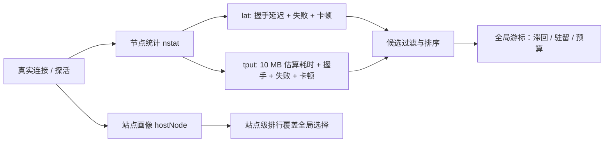

# 节点评分算法分析与 v2 重设计方案

> 历史文档：记录的是当时的方案与实测，**不要照此改代码**；当前设计见 `docs/v8.md` 与 `docs/ARCHITECTURE.md`。

> 分析对象：`../src/nodes/score.ts`、`../src/nodes/metrics.ts`、`../src/nodes/selector.ts`、`../src/proxy/connection.ts` 与相关常量/单测。本文描述当前代码并提出改进方案；不代表建议已合入。

## 结论摘要

当前评分已具备较好的骨架：把延迟与吞吐拆成 `lat` / `tput` 两种代价，考虑失败、卡顿、样本置信度；吞吐以衰减直方图估计，并通过黑名单、滞回、驻留时间和切换预算抑制抖动。单测覆盖了基本排序、门槛、切换和回滚。

优先改进的不是先调权重，而是修正**时间新鲜度与样本语义**：活跃事件才触发统计衰减，评分读取并不衰减；吞吐闸门混用了累计字节与衰减样本数；站点级排序在 `tput` 模式仍按 TTFB 排名，且规范化域名与状态读取键不一致。这些问题会令公式看起来合理、实际选路却用错或用旧数据。

建议按此顺序处理：

1. 评分读取时按当前时间计算有效统计量，并统一计数/吞吐样本的新鲜度。
2. 修正站点级 `tput` 目标与域名族键的一致性。
3. 让吞吐置信度依据吞吐样本本身，而不是连接成功数；明确 seed 数据是否参与排名。
4. 明确 seed 的先验语义、统一有效样本口径，再用可解释分数和回归测试校准参数。

## 当前算法与数据流

### 观测与评分

真实连接关闭时，连接层通过 `nsOk` / `nsFail` 更新可用性；下载窗口通过 `nsSpeed` 写入 log2 直方图；背压通过 `nsStall` 更新卡顿统计。探活另行更新握手信息，但不直接记为真实流量成功。统计半衰期为 6 小时，TCP/TLS EWMA 系数为 0.3，参数见 `../src/core/const.ts`。



`lat` 代价为 TCP、TLS、额外握手往返惩罚、失败惩罚和卡顿惩罚之和。`tput` 以 `10 MB / capBps` 折算毫秒，再加握手、失败、卡顿成本。当前主要常量为 `FAIL=8000`、`STALL=2500`、`PRIOR_BPS=200 KiB/s`；无吞吐样本时 10 MB 先验耗时约 51.2 秒。吞吐候选在本地字节数至少 3 MiB、有效连接数至少 3 且有速率直方图后才采用观测速率，并按 `1-exp(-n/8)` 向先验收缩。

### 选路不只看全局分数

`candsFor()` 会先排除黑名单、冻结节点、低可用性节点和空关闭可疑节点，再按 `costOf()` 升序排列。`maybeSwitch()` 另设滞回、10/20 分钟驻留和每小时切换预算。存在目标站历史时，`Selector.pick()` 还可能用站点画像直接覆盖全局游标；因此应将全局评分与站点评分作为两个相连但不同的算法一起验证。

## 发现与影响

| 优先级 | 发现 | 证据与影响 |
|---|---|---|
| P0 | **分数读取时不执行衰减** | `nsDecay()` 注释写明更新和读分前都要衰减，但调用点集中在 `nsOk/nsFail/nsProbe/nsSpeed/nsStall` 等写入路径；`costOf()`、`candsFor()`、`hostRank()` 读取统计时不调用它（`score.ts:36-44, 54-140, 272-304, 343-354`）。节点空闲期间旧分数不会随时间变旧；流量恢复后的首次选路可能仍依赖陈旧统计。 |
| P1 | **吞吐准入混用累计字节与近期计数** | `nsDecay()` 衰减 `hist/tS/tF`，但不衰减 `bytesDown`；`costOf()` 用 `bytesDown >= 3 MiB` 和衰减的 `n` 共同决定吞吐数据是否有效（`score.ts:41-43, 293-296`）。累计字节不能表示近期样本量或样本质量。应保留累计字节用于面板，但不要用它代表近期可信度。 |
| P1 | **站点 `tput` 排名实际按 TTFB 排** | `hostRank(host, mode)` 虽接收模式，但其调用的 `hostScore()` 不使用 `mode`，只计算 TTFB、失败和过期惩罚（`metrics.ts:124-128, 137-161`）。当站点画像足以覆盖全局选择时，`tput` 请求仍可能选择首字节快但吞吐慢的节点。当前 `HNStat` 也没有站点级吞吐率，不能直接完成正确的 `tput` 排名。 |
| P1 | **站点族规范化后又用原始 host 查表** | `hostRank()` 内部经 `hostKey()` 规范化；但 `Selector.pick()` 随后用原始 `host` 执行 `S.hostNode.get(host)`（`selector.ts:49-58`）。例如记录键为 `x.com`、请求 host 为 `api.x.com` 时，排行可返回数据，但后续样本充分性检查拿不到对应 map，站点排行可能无法覆盖全局选择。 |
| P1 | **吞吐置信度不是由吞吐样本量决定** | `confB` 依赖连接数 `n`，准入还用累计 `bytesDown`；速率直方图每个样本等权（`score.ts:124-132, 293-296`）。连接数不等于速率窗口数；一个大样本与多个独立样本可能获得相近置信度。速率又来自目标站、客户端接收窗口和节点共同作用，可能把客户端限速或目标站波动误认为节点能力（`connection.ts:97-115, 159-165`）。 |
| P2 | **seed 吞吐与准入门槛不一致** | `unpackNode()` 导入 `seedBps` 时把 `bytesDown` 设为 `SC.MIN_BYTES`（1 MiB）；但 `costOf()` 的有效门槛是 3 MiB（`px/seed.ts:49-62`、`score.ts:293`）。因此 seed 速率虽然进入 `capOf()`，却通常无法通过 `okB`，不会按预期贡献 `tput` 分数。需明确 seed 是先验、展示值还是正式观测，避免语义含混。 |
| P2 | **seed 可靠性样本未进入活动失败率/可用性估计** | `packNode()` 将 `okW/failW` 写成 seed 的 `n/f`，`unpackNode()` 也只恢复 `okW/failW`；但 `pFailOf()` 与 `availOf()` 只读取 `tS/tF`。与此同时 `costOf()` 在 `tS+tF` 为零时会用恢复的 `okW+failW` 计算置信度（`px/seed.ts:20-61`、`score.ts:152-183, 280-286, 343-351`）。因此 seed 样本可能提高置信度，却没有提供对应的失败率；候选可用性门槛也看不到 seed 样本。应明确 seed 是可靠性先验还是活样本，并用统一的样本接口处理。 |
| P2 | **风险先验和分数解释需要校准** | `pFailOf()` 采用点估计加标准误，再由 `confF` 收缩；这会使低样本节点出现明显的悲观惩罚。方向合理，但 `FAIL=8000`、`STALL=2500` 与先验的用户体验关系目前没有量化验收标准。面板若只展示总分，也难以判断是延迟、吞吐、失败还是卡顿导致落后。 |

## 建议的 v2 评分算法

### 设计目标

按 Cloudflare Worker 的约束，评分必须是轻量的纯计算，数据按 colo 隔离，不为评分额外拨号；主要性能信号来自真实连接，探活只补充握手延迟。评分的目标是“选一个对当前用途快、稳定且有证据的节点”，不把单次最快值当作长期能力。

为避免不同数据互相污染，统计分成四个维度，各有独立时间戳：

| 维度 | 保存内容 | 用途 |
|---|---|---|
| `traffic` | 衰减成功权重 `okW`、失败权重 `failW` | 可用性与失败风险，只记真实连接 |
| `latency` | TCP/TLS EWMA、探活有效权重、观测时间 | `lat` 排序；探活不计入真实流量可用性 |
| `throughput` | 加权 log2 直方图、权重和、权重平方和、近期有效字节、最后样本时间 | `tput` 排序 |
| `stall` | 衰减卡顿毫秒与运行毫秒 | 两种模式的卡顿惩罚 |

累计总字节仍可用于统计展示，但不参与近期可信度。seed 的延迟/速率/可靠性分别保留为先验来源，不伪装成本地新样本。

### 新鲜度与样本可信度

对每个维度在读分时按半衰期生成有效视图，不修改存储状态：

```text
ageFactor(age) = 2 ^ (-max(0, age) / HL)   # HL 默认 6 小时
有效权重 = 保存权重 × ageFactor
```

写入新样本时，仍先把旧权重衰减到当前时间再累加。评分、可用性门槛、站点排行和解释接口必须使用同一套有效视图。吞吐样本记录 `(bps, bytes, duration, timestamp, hostKey)`，在当前 512 KiB tick 采样基础上继续保留最小质量门槛；按大小和窗口质量赋权，例如：

```text
w = min(1, bytes / 512 KiB) × min(1, duration / 1 s)
histogram[log2Bin(bps)] += w
sumW += w
sumW2 += w²
recentBytesW += bytes × w
nEff = sumW² / max(sumW2, ε)
```

每条连接最多贡献有限权重（例如上限 4），避免一个长连接反复产生窗口样本就支配全局排名。`histogram/sumW/recentBytesW` 随时间乘 `ageFactor`，`sumW2` 乘 `ageFactor²`，以便 `nEff` 保持正确的权重解释。低于现有收尾门槛的样本丢弃；接近门槛的样本可低权重保留。`nEff` 衡量有效速率窗口数，不能用连接成功数代替。

### 风险与卡顿估计

成功/失败只用真实连接更新 `okW/failW`。基础 Beta 先验为 `α=1, β=9`（无 seed 时无数据失败率均值 10%）。同 colo、未过期的 seed 可作为**有上限的先验信息**，但绝不计入本地 `N`：

```text
seedW = min(2, 0.25 × seedN) × 2^(-seedAge / 24h)   # 无 seed 或超过 24h 时为 0
α0 = 1 + seedW × seedFail / max(seedN, 1)
β0 = 9 + seedW × seedOk   / max(seedN, 1)
N  = okW + failW
α  = α0 + failW
β  = β0 + okW
pMean = α / (α + β)
var   = α × β / ((α + β)² × (α + β + 1))
pFailRisk = clamp(pMean + 0.5 × sqrt(var) × (1-exp(-N/4)), 0, 0.9)
```

关键设计：**没有本地样本时 `pFailRisk` 保持先验均值 0.1，而不是因置信区间上界升到约 0.216。**因此基础失败项为 `0.1×8000=800ms`；若用 0.216，则绝对风险项约 1.73s，相对 0.1 的先验增加约 0.93s。观察样本之后才逐步加入有限的不确定性溢价，第一条成功不会额外惩罚未知节点；真实失败仍会立即拉高后验风险。seed 只有限度地修正先验均值，不增加本地样本置信度或可用性计数。

实施时对分数曲线做回放，确认“新节点、少量成功、少量失败、长期健康、近期变差”均按预期排序。连接失败或卡顿会使对应风险成本上升。

```text
pStall = (stallMsW + 50) / (runMsW + 1000)
```

该先验延续当前约 5% 的无样本卡顿率假设。出现连接失败或卡顿时，对应的风险成本会上升；连续失败的熔断/冷却仍由现有状态机处理，不用巨大分数代替熔断。

### 两种目标分数

所有分数保持毫秒当量，越小越好。初版沿用现有 `FAIL=8000`、`STALL=2500`、`TLS_G=1.2`、`LOSS_G=2`、`LOSS_SLACK=30ms`，先修统计语义，不在同一版同时重调权重。

```text
Lobs = tcpEWMA + 1.2 × tlsEWMA
       + 2 × max(0, tlsEWMA - 2 × tcpEWMA - 30ms)

Lprior = alive 探测延迟（若无则 P_TCP + 1.2 × P_TLS）
confL  = 1 - exp(-probeEffectiveN / 4)
L      = confL × Lobs + (1-confL) × Lprior

scoreLat = L + 8000 × pFailRisk + 2500 × pStall
```

吞吐速率用加权直方图分位，保留当前抗突发折中：

```text
p50, p90 = weightedPercentiles(histogram)
capBps   = min(p90, p50 × 2.5)
confB    = min(1, recentBytesW / 3 MiB) × (1 - exp(-nEff / 4))
```

若 `nEff < 3`、近期有效字节不足 3 MiB 或最后样本超过 24 小时，`confB=0`。旧数据通过衰减降权，累计总字节不得让其重新获得资格。

先验吞吐使用同 colo 的 seed（若存在且不超过 24 小时），但 seed 的置信度上限为 0.25，并随时间衰减；没有有效 seed 时沿用 `PRIOR_BPS=200 KiB/s`。这只影响冷启动先验，不计入本地 `nEff`：

```text
cSeed    = 0 (无 seed 或 seed 年龄 > 24h)，否则 0.25 × 2^(-seedAge / 24h)
priorBps = cSeed × seedBps + (1-cSeed) × 200 KiB/s
E10Local = 10 MiB / max(capBps, 8 KiB/s) × 1000 ms
E10Prior = 10 MiB / priorBps × 1000 ms
E10      = confB × E10Local + (1-confB) × E10Prior
scoreTput = E10 + 0.5 × L + 8000 × pFailRisk + 2500 × pStall
```

这样 `tput` 由近期真实速率主导，连接建立成本只占较小比例；未知节点不会因为无吞吐数据被判成最快，也不会因 seed 被误当成新鲜实测而过度自信。低速惩罚只在 `confB` 足够高时启用，避免对无数据节点重复处罚。

示例（假设两者 `confB=1`、忽略握手和卡顿项）：A 为 8 MiB/s、失败风险 30%，吞吐与失败成本约 `1250+2400=3650ms`；B 为 3 MiB/s、失败风险 0.5%，约 `3333+40=3373ms`。B 虽然峰值带宽较低，但总成本更低，体现“快且可用”优于只追求瞬时峰值。

### 过滤、站点画像与切换

- 先保留现有硬规则：不选黑名单/冻结节点；空关闭过滤维持独立。可用性改为同一 `traffic` 有效样本口径。只有 `N>=8` 且以有效样本量近似计算的 95% Wilson 可用性下界低于 0.4 时才硬排除；其他情况主要用 `pFailRisk` 软惩罚，避免小样本一两次失败就永久失去候选资格。该门槛仍需用历史回放校准。
- `hostKey(host)` 作为站点画像唯一索引，写入和读取都用规范化后的 key。`lat` 站点排行使用该站点 TTFB 与失败风险；`tput` 站点排行必须采集该站点的速率窗口并按 `scoreTput` 目标比较。站点级速率样本至少覆盖 512 KiB 才入样本；数据不足时明确回退全局同模式分数，不用 TTFB 冒充吞吐。
- 站点级画像继续受 `HN_MAX_HOSTS/HN_MAX_NODES` 上限约束。站点覆盖全局选择前，要求至少有足够有效样本，并且至少两个候选有可比较数据；未知节点仍可通过探索补样本。
- 冷启动探索自适应：未达 3 个有效速率样本的节点使用最多 10% 新连接影子流量，达到样本目标后降到 5%；每次优先选最久未测的合格节点。站点前几次连接保留有限的站点冷启动试探，但与全局影子比例共用上限，避免两层探索叠加。评分改进不迁移或中断在途连接；影子/试探连接失败只记到对应节点并冻结试探节点，不惩罚主游标。
- 放松硬过滤后 `candsFor()` 候选列表会变长，这是预期行为：排序成本为 `O(C log C)`，`C` 是存活候选数；滞回、驻留、每小时预算和熔断负责控制切换，不靠过早过滤来缩短列表。上线需记录 `candidateCount` 和该阶段 CPU，按最大配置节点数做基准测试。

对外解释分数建议返回同一份分项数据，而不是另写一套诊断公式：`mode`、`score`、`latencyMs`、`e10Ms`、`pFailRisk`、`pStall`、`capBps`、`confB`、`nEff`、`sampleAgeMs`、`priorSource`、`gate`。这也让阈值调优可被观测与回放。

## 关键取舍说明

| 关注点 | 解释与决策 |
|---|---|
| 无数据节点的失败风险偏高 | `pMean + 1.28σ` 会把完全未知节点从 0.1 推到约 0.216，绝对失败项约 1.73s；这对冷启动过于保守。v2 改为无本地样本时使用 0.1 均值，不额外加不确定性溢价；观察到样本后再逐步加入小幅溢价。冷启动仍会比完全无风险节点略差，但少了约 0.93s 的额外惩罚，并由公平探索补样本。 |
| 站点级 `tput` 偏好建立较慢 | 512 KiB 门槛是为了降低小对象、短窗口和客户端波动对站点速率估计的影响。在有效站点样本形成前，明确退回全局 `tput`，这是有意的“暂不使用站点偏好”，不是把 TTFB 误当吞吐。低流量站点可能长期达不到门槛，应接受其持续使用全局排名。冷启动期间探索比例最高 10%，样本达标后回落 5%；站点试探与全局影子共享上限，不叠加。评分本身不会放宽 10/20 分钟驻留与切换预算，因此低流量下收敛仍可能较慢；先观察样本收集时间和失败率，不建议同时缩短驻留期。 |
| seed 不再冒充本地可靠性 | 这是正确的数据语义：跨 isolate 的历史不能增加本机的真实连接数或让可用性硬门槛误判。v2 允许同 colo、24 小时内的 seed 以最多 2 个伪计数、且随时间衰减的方式修正 Beta **先验**，不增加本地 `N` 或 `confB`。没有 seed 时所有节点都从同一个 10% 风险先验开始；有 seed 时也只是有限影响，不会把历史当成本机刚发生的成功。 |
| 候选列表变长 | 门槛放松后更多节点留在 `candsFor()`，属于以软惩罚取代过度硬过滤的预期结果。它增加排序对象数，不增加探测请求；复杂度为 `O(C log C)`，通常应远低于连接处理成本，但仍以最大节点配置压测。切换不会因列表变长自动加快，仍受滞回、驻留期、切换预算和熔断约束。 |

## 建议实施顺序与验收

| 阶段 | 改动 | 验收条件 |
|---|---|---|
| 1 | 实现时间衰减有效视图；累计字节与近期速率样本分离 | 假时钟前进 6h/24h 后，不产生新事件也能降低旧样本权重；累计字节不再单独让旧吞吐样本通过准入 |
| 2 | 修正 hostKey 查表，并支持站点级 `tput` 或明确退回全局 `tput` | `api.x.com` 与 `x.com` 使用同一画像；两个节点 TTFB/吞吐排序相反时，`lat` 与 `tput` 分别选对目标 |
| 3 | 引入吞吐样本有效量与 seed 语义 | 单一高峰样本不会被当成高置信度；无本地样本且无 seed 时 `pFailRisk=0.1`；seed 只以同 colo、最多 2 个衰减伪计数影响先验，不增加本地 `N` |
| 4 | 单一公式、评分解释和灰度观测 | 同一个分项结果同时用于排序与面板；至少记录分数分布、切换次数、成功率、卡顿率、候选数、探索样本收集时间与吞吐样本年龄 |

新增单测至少覆盖：空闲节点随时钟老化、半衰期边界、旧累计字节不能“复活”旧速率、seed 冷启动、一个样本与多个独立样本的置信度差异、站点族别名命中、站点 `lat/tput` 分歧、低置信节点不能因偶然高速样本长期占首位，以及失败/成功后候选门槛的一致性。调参前应做历史样本回放，观察排名稳定性和切换频率；灰度时保留现有评分作为回滚基线。

## 验证记录

- 在 `repo/` 执行 `npm test`：通过。输出包括评分/选择单测 **71 通过、0 失败**，golden **8 项一致**。
- 这证明现有断言与构建契约通过，不代表上述时间老化、站点模式差异和域名族选路边界已经覆盖；建议按验收表补充测试后再改算法参数。
- 主要依据：`../src/nodes/score.ts`、`../src/nodes/metrics.ts`、`../src/nodes/selector.ts`、`../src/proxy/connection.ts`、`../src/px/seed.ts`、`../src/core/const.ts`、`../test/test_score.mjs`。
